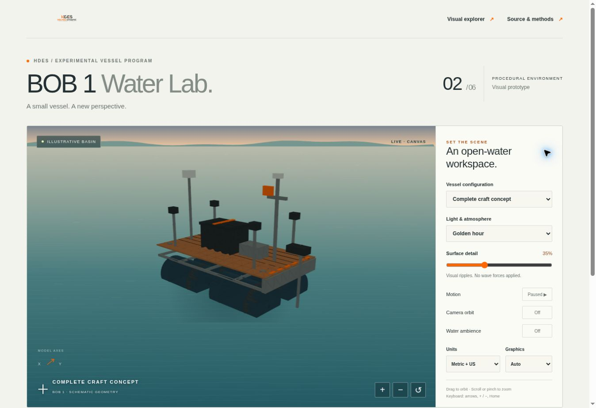
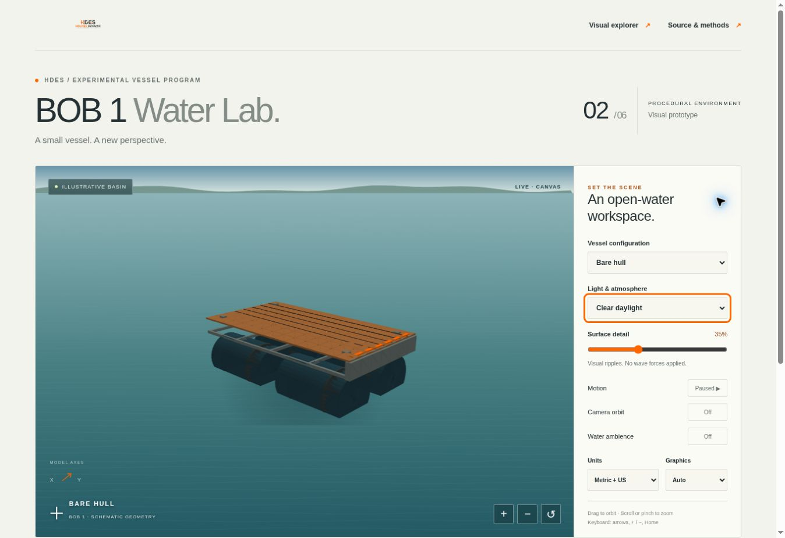
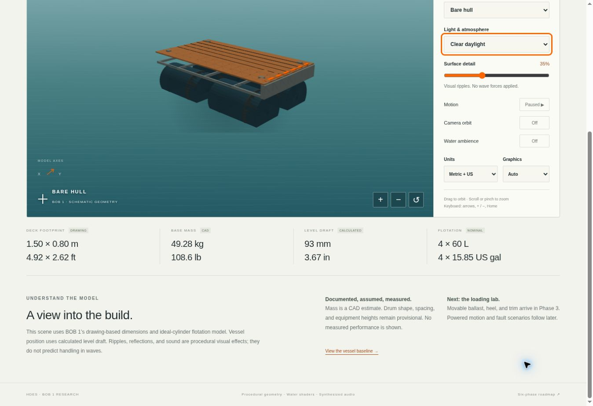

# Phase 2 progress — 1 November 2026

**Evidence type:** Software screenshots from the desktop preview, using the Canvas fallback. These images depict a provisional vessel visualization, not a built or water-tested BOB 1.

**Captured source:** [`798f604`](https://github.com/jvholmes87/piso-aid-bob1/commit/798f6042b2c9baf085f711c27c3151e0e135d785), branch `water-lab/phase-2-environment`, [PR #6](https://github.com/jvholmes87/piso-aid-bob1/pull/6). That PR was open and unmerged when this record was prepared. The images predate this documentation-only follow-up commit.

## Change and result

The Phase 1 baseline had vessel data and flotation calculations but no water environment. Phase 2 adds a procedural water/sky view, generated vessel geometry, lighting presets, camera controls, configuration/unit switching, quality controls and optional synthesized spatial ambience. The existing explorer links to the new lab.

The preview browser could not initialize WebGL 2. A Canvas fallback was added and inspected. During inspection, sorting artifacts on large flat surfaces were reduced through smaller geometry patches, backface rejection and matching edge fills. The remaining image is a simplified view, not a validated native-CAD rendering.

## Visual evidence

### 1. Complete-craft concept in golden-hour lighting

**Caption:** Complete-craft concept with procedural golden-hour lighting, default camera and motion paused. The scene uses the 80.40 kg CAD configuration and its calculated level draft. Equipment presence in this illustration does not imply procurement or installation.

### 2. Bare hull in daylight

**Caption:** Bare-hull concept with daylight lighting and motion paused. The view shows the deck, frame and drum-supported arrangement. The configuration uses a 49.28 kg CAD estimate; geometry and drum spacing remain provisional.

### 3. Reference readouts and model notes

**Caption:** The bare-hull panel shows a 1.50 × 0.80 m drawing-based deck footprint, 49.28 kg CAD mass, approximately 93 mm calculated level draft and four nominal 60 L drums. Metric and US displays refer to the same underlying SI values. These are references and calculations, not physical measurements or a payload rating.

## Checks recorded

| Check | Result |
| --- | --- |
| Phase 1 model suite | Passed reference/limiting/scaling cases, input/provenance checks and 481 force-balance/legacy comparisons. |
| Scene suite | Passed camera transforms across 36 views (3 distances × 3 elevations × 4 azimuths), finite geometry/normals and local resource checks. The earlier console/PR summary overstated this count; the summary is corrected with this record. |
| Existing explorer suite | Passed. Navigation was added and the portable HTML/checksums rebuilt. |
| Browser interaction | Canvas fallback, bare/complete configuration, draft/unit readouts, lighting, pause, orbit, zoom/reset, keyboard actions and audio enable/disable exercised. Sound was enabled through the UI; no acoustic-quality measurement is claimed. |
| Repository content | All 14 Phase 2 implementation files matched their local Git blob hashes before PR creation. |

## Open items and next step

- GPU shader compilation/rendering was not verified because this preview browser does not provide WebGL 2.
- Physical Android performance, pinch behavior and device audio quality remain unverified.
- Roll/trim, movable ballast, environmental forcing, powered motion and fault behavior are later phases. No validated wave response is depicted.
- Phase 3 should add positioned ballast and approximate equilibrium while retaining source/evidence labels and a repeatable record of assumptions.

No Phase 1 water-scene screenshot exists because that phase delivered the software/data foundation. The images above record the present result; they are not presented as a before/after sequence.

Image integrity and capture metadata are recorded in [captures.json](captures.json).

## Publication update — 1 November 2026

PR #6 has since merged. Jason published a walkthrough covering the project goal, Visual Explorer and Water Lab, including the visible deck/frame alignment issue. See the [publication record](publication.md) for the YouTube and X links and verification scope. This later update does not change the renderer or checks recorded for the original screenshots above.
